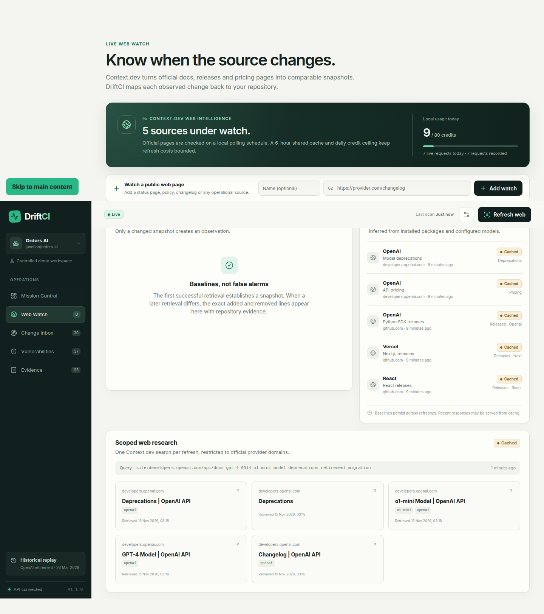

# DriftCI

### The web, watched. The blast radius, known.

DriftCI watches the official web pages your software depends on and connects their changes to exact repository evidence. **Context.dev** retrieves clean page snapshots and scoped research results; DriftCI compares successive snapshots, maps relevant changes to installed packages and configured models, and gives reviewers a traceable decision queue. OSV and CISA KEV add vulnerability and known-exploited intelligence.

**Live demo:** [driftci.ajc.contexio.fi](https://driftci.ajc.contexio.fi) · public, login-free evaluation workspace.



```text
Official docs / releases / pricing             Your repository
              │                                       │
     Context.dev scrape + scoped search        Selective, pinned-commit reads
              │                                       │
     snapshots → observed diffs                 manifests / models / source
              │                                       │
              └──────────► source-to-code impact ◄────┘
                                   │
                     ┌─────────────┴──────────────┐
                     ▼                            ▼
          Reviewed web-change decision     CVE response checklist
          with primary receipts            with advisory receipts
```

## What works

- **Repository-derived web watches.** Configured OpenAI/Anthropic models and supported installed packages select up to six relevant official deprecation, pricing and release pages per refresh. Irrelevant providers are not queried.
- **Real change observations.** The first successful retrieval establishes a baseline. A later content change creates a persistent observation with added/removed line counts, bounded diff excerpts, content hashes and retrieval provenance. Initial baselines never masquerade as new alerts.
- **Source-to-code impact.** Changed pricing/model text is matched against exact model identifiers. Release watches attach their installed dependency declarations. Every signal leads to primary sources and repository locations, then supports **Mark reviewed** and **Resolve** workflow transitions.
- **Custom watches.** Add a public HTTPS status page, policy or changelog. Watches are capped at 12 custom URLs and share the same snapshot/cache pipeline.
- **Scoped Context.dev research.** One official-domain search per refresh adds up to five citable results with exact repository-term matches. The backend rejects results from outside the requested official host.
- **Vulnerability response.** OSV determines affected installed versions, CISA KEV marks known exploitation, and repository analysis adds labelled reachability clues. Persistent checklists, CVE history and Markdown incident exports support the response.

The UI distinguishes **live**, **cached**, **historical replay**, **partial**, and **unconfigured** evidence. It has no AI patch-generation buttons.

## Quickstart

Requirements: Python 3.11+ (3.12 recommended), Node 20+ and npm.

```bash
cd driftci
make setup
cd web && npm run build && cd ..
.venv/bin/python -m uvicorn server.main:app --host 127.0.0.1 --port 8100
```

Open **http://127.0.0.1:8100**. The seeded `junction/orders-ai` example works without credentials or network access. Use **Repository and demo controls** to connect a public GitHub repository, restore the example, or replay a clearly labelled historical model retirement.

For development, run `make api` and `make web` in separate terminals. Vite listens on port 5173 and proxies the API to port 8100.

## Context.dev usage and budget

Set the key outside source control:

```bash
set -a
. ~/.config/contextdev/api.env   # CONTEXTDEV_API_KEY=...
set +a
.venv/bin/python -m uvicorn server.main:app --host 127.0.0.1 --port 8100
```

Click **Refresh web**. The backend retrieves official pages with `POST /v1/web/scrape` and performs at most one relevant `POST /v1/web/search`. Individual failures preserve last-known evidence and are reported on the affected source.

Rate and credit controls are deliberate:

| Control | Default |
|---|---|
| Fresh scrape cache / scoped-search cache | 6 hours |
| Global Context.dev request pacing | 6.2 seconds |
| Official scraped pages per refresh | 6 maximum |
| Scoped searches per refresh | 1 maximum, 5 results |
| Local daily credit ceiling | 80, reserving expected credits before each request |
| Local scan serialization/cooldown | One shared lock / 30 seconds |
| Background polling | Every 15 minutes when enabled |

Fresh-cache hits consume no new Context.dev call. When the daily ceiling is reached, fresh cache remains available and new calls stop with a visible source error. `DRIFTCI_CONTEXT_CACHE_TTL`, `CONTEXTDEV_MIN_INTERVAL`, `CONTEXTDEV_MAX_SOURCES`, and `CONTEXTDEV_DAILY_CREDIT_LIMIT` adjust these bounds server-side.

The UI counters are **locally recorded** requests and credits. They are not a substitute for account-side dashboard reconciliation. The background watcher is local polling with persistent baselines and diffs; DriftCI does not create or claim Context.dev monitor resources, monitor IDs, webhooks, or remote schedules.

OSV and CISA use their own public endpoints and caches. They are not proxied through Context.dev.

## Selective GitHub reading

Use **Connect repository** with a canonical public `https://github.com/owner/repository` URL. DriftCI:

1. Resolves repository metadata, default branch and immutable commit SHA through GitHub's API.
2. Reads recursive tree metadata at that commit, rather than downloading a clone or archive.
3. Selects dependency manifests first, then allowlisted application source/config files. Documentation, media, tests, `node_modules`, build output, caches and vendor directories are excluded.
4. Reads selected UTF-8 files from `raw.githubusercontent.com` at the same pinned commit.
5. Retains nested manifest scopes and reports bytes, commit, skipped files, timeouts and partial coverage.

Defaults are **120 selected files / 4 MB total / 1 MB per file / 25 seconds** for source reads, with eight concurrent reads and a 6-second per-file deadline. The whole connection has a 90-second timeout. Adjust file/byte limits with `DRIFTCI_GITHUB_FILE_LIMIT`, `DRIFTCI_GITHUB_BYTE_LIMIT`, and `DRIFTCI_GITHUB_FILE_BYTE_LIMIT`.

The inventory covers supported npm/PyPI manifests, not every native/transitive component of a large repository. Partial source or vulnerability coverage never proves absence or safety. OSV queries at most 32 exact installed packages with four concurrent workers and a 25-second batch deadline; pending packages are shown explicitly.

Repository code and package scripts are never installed, imported, or executed. Source contents stay out of Context.dev calls; OSV receives only ecosystem/package/version queries. A GitHub token, if configured, is used only on `api.github.com` and is never forwarded to the raw host.

## Core workflows

### Live web change → review

1. Open **Web Watch** to inspect inferred sources, the local daily budget and scoped research.
2. The first retrieval establishes a baseline. Later changed snapshots appear with added/removed lines and source hashes.
3. Open a signal to inspect its primary receipt and exact source/dependency locations.
4. Review the recommendation, validate impact in the application, then mark it reviewed or resolve it.

### Model retirement

The example contains `gpt-4-0314` in two production source locations. A live OpenAI lifecycle-page retrieval produces exact retirement evidence and migration guidance. The optional replay uses the same shape with an explicit **historical replay** label.

### CVE response

1. Open **Vulnerabilities** and inspect the OSV/CISA receipts, installed range and fixed version.
2. Treat repository reachability as a clue, not proof of exploitability.
3. Complete acknowledge, contain, patch, verify and resolve steps in order.
4. Export the Markdown incident record with impact, uncertainty, evidence and response timestamps.

The intentionally outdated example can return many real Next.js advisories during a live OSV scan. Findings are retained rather than hidden to make the dashboard quieter.

## API

Interactive FastAPI documentation is available at `/docs`.

| Endpoint | Purpose |
|---|---|
| `GET /api/health` | Integration status, local polling and Context.dev usage/budget |
| `GET /api/bootstrap` | Workspace, signals, sources, observations, research, dependencies and incidents |
| `POST /api/scan` | Shared-cache source and vulnerability refresh |
| `POST /api/repositories/connect` | Selectively read and scan a public GitHub repository |
| `GET /api/signals` / `GET /api/signals/{id}` | Filter or inspect source-to-code decisions |
| `POST /api/signals/{id}/state` | Mark reviewed, monitoring, needs action, or resolve non-CVE signals |
| `POST /api/watches` / `DELETE /api/watches/{key}` | Add/remove a public custom HTTPS watch |
| `GET /api/incidents` | Active and resolved vulnerability response |
| `POST /api/incidents/{id}/actions/{action}` | Update ordered incident checklist state |
| `GET /api/incidents/{id}/report` | Download a Markdown incident-response record |
| `POST /api/demo/replay` / `POST /api/demo/reset` | Replay/reset the labelled historical example |

## Tests and validation

```bash
make test
```

This builds the TypeScript frontend and runs **35 backend tests** without live network dependencies. Tests cover inventory parsing, advisory ranges, lifecycle tables, cache accounting, budget enforcement, first-baseline versus subsequent-change behavior, bounded diffs, official-host filtering, custom URLs, review transitions, selective pinned-commit reads and partial coverage.

Run real Chromium QA against a running service:

```bash
DRIFTCI_URL=http://10.0.2.2:8100 ./scripts/browser-smoke-docker.sh
```

The current suite checks the live-source Mission Control, signal review, five-watch Web Watch and research receipts, the no-patch change inbox, CVE checklist/export/history, selective source bounds, and 390px layouts with zero JavaScript errors. It resets the shared demo unless `DRIFTCI_KEEP_WORKSPACE=1` is set. Its refresh honors the same cooldown and six-hour caches as the product.

## Engineering and deployment

- FastAPI, SQLite, httpx and Pydantic on the backend.
- React, TypeScript, Vite, Inter and lucide-react on the frontend.
- Atomic SQLite writes; compact per-source snapshots and bounded observation history.
- Sanitized, length-capped web text; no repository or web-content execution.
- Production service `driftci-app` on `127.0.0.1:8100`; Caddy serves the public HTTPS route.
- See `DEMO.md`, `THREAT_MODEL.md`, `EVIDENCE.md`, and `HANDOFF.md` for the demo script, boundaries, live validation and operational state.
