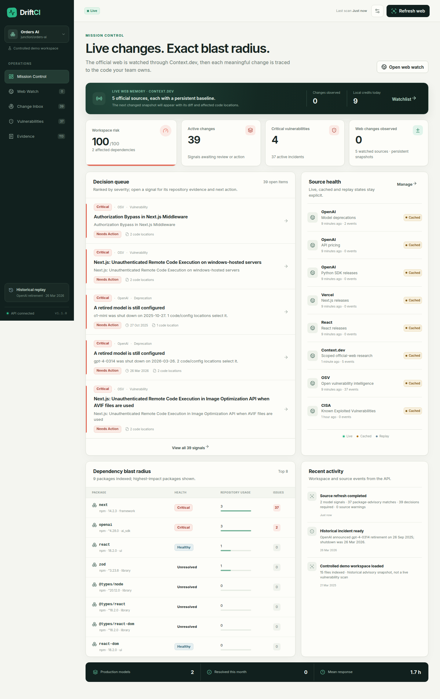

# DriftCI

### Your dependencies changed. Your codebase got the memo.

DriftCI turns live-web dependency changes into repository-aware decisions and reviewable action. It watches official model/API documentation with **Context.dev**, checks dependency versions against **OSV** and **CISA Known Exploited Vulnerabilities**, maps material changes to exact source files, and produces deterministic remediation patches with evidence and targeted checks.

It is designed as **mission control for AI application teams**, not another dependency dashboard or chatbot.

**Live demo:** [driftci.ajc.contexio.fi](https://driftci.ajc.contexio.fi) · public, login-free evaluation workspace with a shared demo reset.



```text
Official docs / OSV / CISA                  Your repository
          │                                       │
          ▼                                       ▼
  Context.dev + source receipts       Deterministic inventory + source index
          │                                       │
          └──────────────► material change ◄──────┘
                                  │
                         exact blast radius
                                  │
                    ┌─────────────┴──────────────┐
                    ▼                            ▼
         Reviewable remediation         CVE incident response
         patch + targeted checks        checklist + evidence history
                    │                            │
                    └──────► human approval ◄────┘
                                  │
                       patch export or GitHub PR
```

## Why it is different

- **Watches what package managers miss:** model shutdowns, legacy identifiers, API deprecations and official documentation changes.
- **Connects external change to internal evidence:** affected model identifiers, package versions and relevant middleware/source files.
- **Makes severity honest:** installed, exact-use-confirmed and pattern-likely reachability are different states.
- **Supports incident response:** active CVEs have a persistent checklist, fixed-version guidance, evidence receipts and resolution history.
- **Produces action:** real unified patches, approval tracking and patch export; optional GitHub integration opens a branch and pull request.
- **Does not invent execution:** checks are explicitly the static checks DriftCI ran. Application tests and model evaluations remain visible human/CI steps.

## Quickstart

Requirements: Python 3.11+ (3.12 recommended), Node 20+ and npm.

```bash
cd driftci
make setup
```

Run the production-like application (FastAPI serves the built frontend):

```bash
cd web && npm run build && cd ..
.venv/bin/python -m uvicorn server.main:app --host 127.0.0.1 --port 8100
```

Open **http://127.0.0.1:8100**. The seeded example works without credentials or network access.

For development with hot reload:

```bash
# Terminal 1
make api

# Terminal 2
make web
```

Vite runs on `http://127.0.0.1:5173` and proxies API calls to port 8100.

## Enable live web intelligence

Context.dev is optional for the replay demo but is the intended live mode. Set its key in the environment, never in a source file:

```bash
set -a
. ~/.config/contextdev/api.env   # contains CONTEXTDEV_API_KEY
set +a
.venv/bin/python -m uvicorn server.main:app --host 127.0.0.1 --port 8100
```

Click **Scan now**. DriftCI requests a structured/markdown representation of official documentation through Context.dev, validates the response, records retrieval provenance and caches it. Individual source failures are surfaced and do not erase last-known evidence.

Set `DRIFTCI_WATCH_INTERVAL_SECONDS=900` to poll every 15 minutes in the background. `DRIFTCI_SCAN_COOLDOWN_SECONDS=30` plus a shared scan lock protects upstream services from repeated public requests; scheduled and manual scans share that lock. Network polling is disabled by default for deterministic tests and local startup unless explicitly configured.

OSV and CISA use their public endpoints when a live vulnerability scan runs. No key is required for the public OSV queries used here. Respect upstream rate limits and terms for production use.

## Connect a repository

Use **Connect repository** and provide a public GitHub URL. **There is no repository ZIP, clone, install or 25 MB repository-archive limit.**

The selective reader:

1. Resolves repository metadata, the default branch and its immutable commit SHA.
2. Reads GitHub's recursive **tree metadata at that commit**, not the repository archive.
3. Selects dependency manifests first, then allowlisted application source/config files. Documentation, media, `node_modules`, build output, caches and vendor directories are filtered out before content requests.
4. Reads only selected UTF-8 files from `raw.githubusercontent.com`, pinned to that same commit. Nested `package.json`/`package-lock.json`, `pyproject.toml` and requirements files retain separate manifest scopes.
5. Shows files read, bytes read, skipped files and complete/partial coverage. A partial scan never claims that missing findings prove absence.

Default source-reading bounds are **64 selected files / 2 MB total / 1 MB per file / 25 seconds**, independent of total repository size. Per-file reads expire after 6 seconds; selected files completed before the deadline are retained. Test fixtures and documentation directories are excluded from production indexing. `nodejs/node` is a supported large-repository stress case, but npm/PyPI manifests—not every C/C++ runtime component—are inventoried.

Adjust file/byte bounds server-side with `DRIFTCI_GITHUB_FILE_LIMIT`, `DRIFTCI_GITHUB_BYTE_LIMIT` and `DRIFTCI_GITHUB_FILE_BYTE_LIMIT`. The entire connection has a 75-second timeout (`DRIFTCI_REPOSITORY_CONNECT_TIMEOUT_SECONDS`) so the browser cannot spin indefinitely. OSV uses four bounded concurrent workers, at most 32 exact packages per scan (`DRIFTCI_OSV_PACKAGE_LIMIT`, zero disables the cap for a controlled private deployment) and a 25-second batch deadline (`DRIFTCI_OSV_BATCH_SECONDS`). Package-query timeouts and pending packages are shown as partial vulnerability coverage, never as proof of safety.

If a GitHub tree is truncated or the budget is reached, the UI shows a partial-coverage warning. Dependency usage and model evidence are indexed once per source set rather than rescanned per package or lifecycle event, so large-tree bootstrap requests do not block the API event loop.

The scanner never executes repository code or package lifecycle scripts. GitHub credentials, when configured, go only to `api.github.com` for repository metadata/rate limits and PR operations—never to the raw host. Source contents are not sent to Context.dev; OSV receives only inventoried package/version queries.

For application-report links or exhaustive whole-repository SBOMs, add a scoped CI connector rather than making a browser client download the repository.

The built-in `examples/orders-ai` fixture intentionally has an outdated Next.js version, middleware authorization logic and retired OpenAI model identifiers. **Do not deploy that fixture.**

## Optional GitHub pull requests

Set a fine-grained `GITHUB_TOKEN` with permission to create branches, update contents and open pull requests in the connected repository. Then generate a remediation, review its diff and explicitly request PR creation.

Without a token, **Approve & export** creates a downloadable `.patch` and honestly reports that no GitHub PR was created. DriftCI never merges a PR, pushes to the default branch or deploys.

Use a least-privilege token for a test repository during demos. Keep the token outside the repository.

## Core workflows

### Model/API change

1. DriftCI retrieves official documentation and records a source receipt.
2. The model/API identifier is matched against deterministic repository evidence.
3. A material event produces a decision card, affected assets and a recommended migration.
4. **Generate fix** renders file-level unified diffs and targeted static checks.
5. A reviewer approves and exports the patch or opens a draft PR.

### CVE and vulnerability response

1. OSV resolves current vulnerabilities for each inventoried ecosystem/package/version.
2. CISA KEV marks vulnerabilities known to be exploited when present in that catalog.
3. Source analysis adds explicit usage or reachability clues, with uncertainty preserved.
4. The incident checklist tracks acknowledge, contain, patch, verify and resolve steps.
5. **Export IR record** creates a real Markdown incident report with impact, repository evidence, checklist timestamps and advisory receipts.
6. The vulnerability view retains resolved history and upstream evidence for incident learning.

A CVE affecting an installed package is **not automatically proof of exploitability**. DriftCI says what it checked and leaves deployment-specific verification to the response team.

## API

FastAPI exposes interactive documentation at `/docs`.

| Endpoint | Purpose |
|---|---|
| `GET /api/health` | Integration and runtime status |
| `GET /api/bootstrap` | Workspace, summary, signals, dependencies, sources, activity and incidents |
| `POST /api/scan` | Refresh live sources and vulnerability intelligence |
| `POST /api/repositories/connect` | Connect and scan a public GitHub repository |
| `GET /api/signals` | Filter material change/security signals |
| `POST /api/remediations` | Generate a deterministic remediation preview |
| `GET /api/remediations/{id}` | Retrieve diffs, checks and evidence |
| `POST /api/remediations/{id}/approve` | Record human approval |
| `GET /api/remediations/{id}/patch` | Download the actual unified patch |
| `POST /api/remediations/{id}/open-pr` | Optionally open a GitHub PR |
| `GET /api/incidents` | Active vulnerability response and history |
| `POST /api/incidents/{id}/actions/{action}` | Update incident checklist state |
| `GET /api/incidents/{id}/report` | Download a Markdown incident-response record |
| `POST /api/demo/replay` | Replay the labelled historical model retirement |
| `POST /api/demo/reset` | Restore the deterministic demo |

See `PRODUCT.md` for data shapes and `DEMO.md` for the 90-second judging script.

## Tests and validation

```bash
make test
```

This builds the TypeScript frontend and runs deterministic backend tests without live network dependencies. Unit tests cover the risky logic—inventory parsing, version/fixed-range analysis, source matching, real OpenAI table structures, patch generation, selective pinned-commit GitHub reads, scan-coverage accounting, source budgets and state transitions—rather than relying exclusively on screenshots.

Run the credential-free workflow against a running service:

```bash
.venv/bin/python scripts/smoke.py http://127.0.0.1:8100
```

Run real Chromium QA (desktop, model evidence/diff/export, CVE response/report, history and 390px mobile) with no host browser dependencies beyond Docker:

```bash
DRIFTCI_URL=http://10.0.2.2:8100 ./scripts/browser-smoke-docker.sh
```

Use `DRIFTCI_URL=https://driftci.ajc.contexio.fi` to test the deployed route. Screenshots and exported artifacts are written to `/tmp/driftci-browser/public` by default; by default the browser test resets the shared demo before and after running.

To repeat the real large-repository browser check, add `DRIFTCI_REPOSITORY=https://github.com/nodejs/node`. Add `DRIFTCI_KEEP_WORKSPACE=1` to retain that repository for inspection rather than restore the demo (currently retained on the public deployment).

## Docker

```bash
CONTEXTDEV_API_KEY=... docker compose up --build
```

The container runs as an unprivileged user and stores SQLite state in a named volume. Put it behind authenticated TLS before exposing a real repository workspace.

## Engineering and safety

- FastAPI, SQLite, httpx and Pydantic on the backend.
- React, TypeScript, Vite and lucide-react on the frontend.
- SQLite persistence for workspace, evidence, remediations and incident actions.
- Atomic source snapshots and last-known-good cache behavior.
- No repository execution, no web-content execution and no secret values in receipts.
- See `THREAT_MODEL.md` for boundaries and production hardening requirements.

## Competitive focus

DriftCI deliberately optimizes one demonstrable loop:

> **One live change → one precise blast radius → one evidence-backed response.**

The result is useful before AI generates anything: dependency/version matching, source mapping, patches and incident state are deterministic and inspectable. Context.dev is essential for turning the unstructured operational web into current, citable signals.
