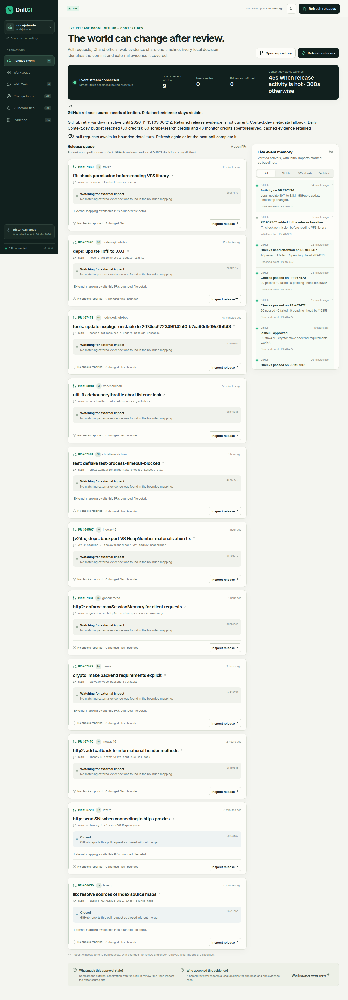

# DriftCI

### The world can change after review.

DriftCI connects **live GitHub pull requests and CI** to the **official web evidence** your application depends on. Pull requests, reviews, checks and Context.dev observations share one durable event timeline. Reviewers can see whether external evidence is still relevant and record a decision for one exact commit and evidence snapshot.

**Context.dev** retrieves and searches official model lifecycle, pricing, SDK-release and status pages, preserves public GitHub API metadata through its byte transport, and executes the repository's hosted hourly security monitor. DriftCI owns repository analysis, change detection, evidence mapping and local review decisions. OSV and CISA KEV supply separate vulnerability evidence.

**Live demo:** [driftci.ajc.contexio.fi](https://driftci.ajc.contexio.fi) · public, login-free evaluation workspace.



```text
GitHub metadata / bounded diffs              Official web sources
PR heads / reviews / checks                 Context.dev web + scoped search
tree / graph / selected raw reads           + public GitHub metadata bytes
              │                             + remote monitor records
              ▼                                        │
Pinned inventory + exact PR evidence                   ▼
dependencies / native declarations            snapshots / observations
scoped OSV + CISA matches                 hosted schedule / change receipts
              └──────────┬─────────────────────────────┘
                         ▼
        Sequenced events / SSE / scoped evidence
                         ▼
       Named local decision + exact-head receipt
```

## What works

- **A live Release Room.** Read recent public pull requests, exact head commits, changed files, reviews and GitHub check runs without downloading the repository again. GitHub reviews are displayed separately from local DriftCI decisions.
- **Durable events and browser updates.** SQLite assigns monotonically increasing event IDs. `/api/events/stream` supports replay, `Last-Event-ID` and reconnecting browser updates. Initial indexing is marked as a baseline; live polling does not synthesize activity.
- **Post-review evidence checks.** A later relevant official-web observation can mark an earlier approval or local decision stale. A new PR head also invalidates the earlier decision. The source diff, PR head, review time and observation time remain inspectable.
- **Accountable release decisions.** A named reviewer records `ready` or `hold` locally for one PR head and evidence hash. Ready decisions require fresh GitHub retrieval and complete bounded file/review/check coverage; pending or failing checks block ready. Neither operation approves, merges or modifies GitHub.
- **Repository-derived Context.dev watches.** Up to six relevant official deprecation, pricing, SDK/framework-release and status pages derive from configured models and installed packages. One scoped official-domain search adds at most five research results.
- **Persistent web observations.** The first successful snapshot is a baseline. Subsequent normalized content differences create bounded added/removed excerpts, content hashes and retrieval provenance. Stock page timestamps and navigation are not semantic service-status changes.
- **Precise PR matching.** Matching uses added/context lines and current paths from bounded PR diffs. Removed lines and deleted files do not count as current configuration. Existing repository evidence supplies additional paths, with explicit partial-coverage limits.
- **Targeted large-repository inventory.** Read the commit tree, GitHub dependency graph, manifests, lockfiles, native-version declarations and selected old source without archives, clones, installs or repository execution. Manifest/read, parser, source, unresolved-version and advisory-query coverage are reported separately.
- **Evidence and incident response.** OSV batches are expanded to full advisory records before affected-range matching. Every occurrence retains its package version, scope and evidence manifest through the signal, incident and Markdown export. Bundled/test/documentation/dependency-graph findings are inventory evidence, not production-exploitability claims. Native declarations require platform-specific review.
- **Real hosted monitoring.** A reusable Context.dev remote hourly resource supplies monitor/run/change records. Baselines and no-change runs do not create alerts. Local reconciliation is displayed separately from the remote scheduler; Context.dev monitor webhooks are not implemented.
- **Shared credit accounting.** Settled ordinary usage, monitor commitments and in-flight reservations reduce the configured daily availability. Monitor creation checks the same shared budget before making a request.

The interface distinguishes **live**, **cached**, **historical replay**, **partial**, **stale** and **unconfigured** evidence. It has no AI patch-generation actions.

## Current public demonstration

The connected public workspace is **`nodejs/node`**, pinned to `c07db8c5c1b1b18e1e0e088b83f56922c142c0cf`. Its selective index contains **1,600 records / 20,521,906 bytes**, all 525 discovered manifest candidates, 67 native-version files and 753 dependency-graph packages. Five invalid test-fixture manifests remain explicit parse errors. The 56,696-entry tree is complete, while broader source coverage remains partial. The public OSV pass checked **5,581/5,581** supported exact comparisons and retrieved **157/157** advisory details. Its 206 package/manifest matches comprise 204 bundled and two dependency-graph findings; they cover 98 unique CVEs and are not 206 production exploits.

The Release Room reads a recent window of at most ten PRs. Repository connect retrieves the lightweight PR index first; detail is retrieved later in bounded turns and remains visibly incomplete until available. This is a public-repository demonstration, not a Node.js-operated release console or an endorsement of GitHub approvals.

`junction/orders-ai` remains the small deliberately outdated example. Use **Repository and demo controls** to restore it or replay the clearly labelled historical OpenAI retirement. Live sources and historical replay are separate states.

## Quickstart

Requirements: Python 3.11+ (3.12 recommended), Node 20+ and npm.

```bash
cd driftci
make setup
cd web && npm run build && cd ..
.venv/bin/python -m uvicorn server.main:app --host 127.0.0.1 --port 8100
```

Open **http://127.0.0.1:8100**. The seeded example works without credentials or network access. Use `make api` and `make web` in separate terminals for development; Vite listens on 5173 and proxies the API to 8100.

Set Context.dev credentials outside source control:

```bash
set -a
. ~/.config/contextdev/api.env
set +a
```

Optional GitHub settings use `GITHUB_TOKEN` and `DRIFTCI_GITHUB_WEBHOOK_SECRET`; see `.env.example`. The GitHub token is sent only to `api.github.com`. The webhook secret is separate. Release polling remains the fallback when no webhook is configured.

## Request and credit controls

| Source or operation | Default bound |
|---|---|
| Ordinary Context.dev scrape/search cache | 6 hours |
| Provider-status cache | 300 seconds |
| Hot provider-status cache | 45 seconds; eligible on the next release poll |
| Context.dev request pacing | 6.2 seconds |
| Context.dev sources / searches per ordinary refresh | 6 pages / 1 search with up to 5 results |
| Context.dev local daily ceiling | 10,000 credits, reserved before a request |
| Background full web/CVE refresh | 15 minutes, shared scan lock and 30-second cooldown |
| Recent GitHub PR polling | 90 seconds, with persistent ETags |
| Recent PR baseline window | At most 10 records |
| New PR detail turns | 2 PRs per polling pass, 3 detail reads each |
| PR changed files | First 30 files, 12,000 diff characters per file |
| Reviews / check runs | First 50 per PR/head |
| GitHub release metadata response | 2 MB maximum |
| Targeted repository index | 1,600 records, 32 MB total, 2 MB per file, 40 source-read seconds |
| GitHub metadata via Context.dev | Public `api.github.com` JSON only; base64/body-size/content-type validation |
| Dependency graph / SBOM metadata | 12 MB body limit |
| OSV advisory comparison | Exact supported versions only; 16,000-package cap, bounded batch deadline |
| Hosted hourly monitor budget | 48 credits/day, reconciled using real remote run credit data |
| GitHub webhook payload | 512 KB maximum, HMAC-SHA256 required |

Hot status mode applies when an open PR has pending checks or was updated within 15 minutes. It does not make ordinary pricing and documentation pages poll every 45 seconds. Cached Context.dev responses consume no new request. PR events retrieve metadata and bounded diffs, not a full repository rescan or search request.

Permanent bounds, such as a 30-file PR window or omitted large-file patch, do not cause the same PR detail to be downloaded every cycle. Failed detail requests remain retryable when the PR is retried. Partial evidence stays marked as partial and cannot receive a ready decision.

GitHub quota errors retain existing evidence and create a visible source warning. Persistent retry windows honor `Retry-After` and reset headers; repeated failures without retry metadata use bounded exponential backoff. A suppressed retry makes no upstream request. A least-privilege read-only token is recommended for an active public demonstration because anonymous GitHub API capacity is small.

Context.dev counters are **locally recorded** request and credit usage, not account-side billing reconciliation. Ordinary polling is local DriftCI polling using Context.dev Scrape/Search. The separate Context.dev remote monitor has ID `mon_69e93e826b1f4d3993f6334286174703` and real hourly run records. Baselines, failed/skipped runs and no-change completions are distinguished in the UI. Context.dev monitor webhooks are not implemented; an optional verified GitHub webhook is a separate integration.

Public GitHub API metadata can use Context.dev's byte-preserving transport and consumes its measured ordinary credits. Selective raw source reads remain direct and immutable-SHA-pinned. GitHub authorization is sent only to direct `api.github.com` requests, never through Context.dev or to raw-content hosts. Context.dev fallback failures and direct GitHub transport errors are disclosed rather than hidden.

OSV and CISA use their own public endpoints. They do not consume Context.dev credits.

## Source and evidence boundaries

Repository connection accepts a canonical public `https://github.com/owner/repository` URL. DriftCI resolves a commit, reads its tree and selectively fetches manifests and application/config source. Root manifests and runtime provider integrations are prioritized over nested examples; tests, fixtures, snapshots, vendor trees, build output, documentation and media are excluded from model evidence. Source is read as untrusted text and never installed, imported or executed.

Nested manifest and bundled scopes are preserved. Inventory includes application, test, example, documentation, native and bundled declarations with scope labels; model evidence remains restricted to application source. Large repositories and package sets may be partially covered. Context.dev receives requested public web/API URLs and repository-derived search terms, never source contents. OSV receives only supported exact package ecosystem/name/version tuples; native declarations and unresolved ranges stay visible as review gaps.

PR evidence accounts for real coverage boundaries:

- Pull-list metadata is not the same as a complete file, review and check retrieval.
- The source inventory is a base-branch pinned commit. Each PR separately stores a bounded diff at its head; it is not a fresh repository-wide source index.
- Model identifiers found in source, including SDK compatibility catalogs, do not prove runtime invocation.
- Omitted, binary or truncated patches keep file coverage incomplete.
- Only added/context lines participate in matching; deleted code is not current code at the PR head.
- A stable coverage bound does not justify repeated downloads. A changed head or a retried request can retrieve fresh detail.
- GitHub checks are recorded, not executed by DriftCI. No reported checks does not mean tests passed.
- GitHub approvals and local release decisions are distinct records.

## Review-to-release workflow

1. **Open Release Room.** Inspect the PR head, changed files, checks and matching external evidence. Check the independent GitHub freshness and event-stream indicators.
2. **Inspect external evidence.** Follow official receipts and bounded before/after excerpts. `Review external evidence` can refer to an existing lifecycle baseline; `External evidence postdates approval` specifically compares a new observation with the retrieved approval time.
3. **Resolve material uncertainty.** Use Web Watch or the Change Inbox to inspect the external source. Existing review/resolve states do not replace application validation.
4. **Record a local decision.** The named reviewer supplies an optional evidence note, then records ready or hold. The receipt binds that person, PR head and evidence hash.
5. **Export the Markdown record.** It contains exact head/evidence hashes, retrieved checks, files, source fingerprints, acknowledgment notes and remaining limitations.
6. **Revisit after change.** A later matching observation or a new head makes the previous decision stale. DriftCI never merges, deploys or silently restores a previous approval.

## API

Interactive FastAPI documentation is available at `/docs`. JSON API responses use `Cache-Control: no-cache`.

| Endpoint | Purpose |
|---|---|
| `GET /api/health` | Context.dev budget, source health and independent GitHub release-stream freshness |
| `GET /api/bootstrap` | Workspace, PRs, events, signals, sources, dependencies and incidents |
| `POST /api/scan` | Ordinary shared-cache web and vulnerability refresh |
| `POST /api/releases/refresh` | Bounded PR/check ingestion and activity-scoped status watching |
| `GET /api/events/stream?after=SEQ` | Replay and follow monotonically sequenced events over SSE |
| `POST /api/github/webhook` | Verified GitHub input, when its separate secret is configured |
| `POST /api/releases/{id}/decision` | Record named local `ready`/`hold` for an exact head/evidence set |
| `GET /api/releases/{id}/report` | Export the exact-head Markdown release decision receipt |
| `POST /api/repositories/connect` | Selectively read and scan a public GitHub repository |
| `GET /api/signals` / `GET /api/signals/{id}` | Filter or inspect source-to-code evidence |
| `POST /api/signals/{id}/state` | Record human review state for non-CVE signals |
| `POST /api/watches` / `DELETE /api/watches/{key}` | Add/remove a public custom HTTPS watch |
| `GET /api/incidents` | Active vulnerability response and retained history |
| `POST /api/incidents/{id}/actions/{action}` | Update the ordered response checklist |
| `GET /api/incidents/{id}/report` | Export a Markdown incident record |
| `POST /api/demo/replay` / `POST /api/demo/reset` | Replay/reset the labelled historical example |

## Tests and validation

```bash
make test
```

This builds the frontend and runs **67 backend tests**. Coverage includes lifecycle parsing, live mocked observations, shared cache/credit and in-flight reservation accounting, scoped repository inventory, successful/partial source reads, advisory-detail expansion and pagination, application-only remediation, monitor baselines/schedules, event replay, HMAC validation and deduplication, PR head changes, later external evidence, decision expiry, removed-code diffs, oversized patches, index-only PR detail, ETag quiet polling and rate-limit suppression.

Run real Chromium QA:

```bash
# The release suite read-only by default against a real connected workspace.
DRIFTCI_URL=https://driftci.ajc.contexio.fi \
  DRIFTCI_QA_SCRIPT=release-smoke.cjs ./scripts/browser-smoke-docker.sh

# Explicitly exercise a local pause on the shared workspace; never changes GitHub.
DRIFTCI_RELEASE_DECISION_QA=1 \
  DRIFTCI_URL=http://10.0.2.2:8100 \
  DRIFTCI_QA_SCRIPT=release-smoke.cjs ./scripts/browser-smoke-docker.sh

# Read-only real coverage, incident-scope and hosted-monitor evidence.
DRIFTCI_QA_SCRIPT=coverage-smoke.cjs DRIFTCI_REPOSITORY=nodejs-node \
  DRIFTCI_QA_OUT=/tmp/driftci-coverage-final \
  ./scripts/browser-smoke-docker.sh http://10.0.2.2:8100

# Legacy review/incident UI. The wrapper ALWAYS starts an isolated offline
# server and a fresh database, even if a public target was supplied.
DRIFTCI_QA_OUT=/tmp/driftci-legacy-final \
  DRIFTCI_QA_SCRIPT=browser-smoke.cjs ./scripts/browser-smoke-docker.sh
```

The wrapper defaults to the Release Room script and accepts one optional target argument. Legacy reset/replay actions are confined to the isolated database. The isolated legacy suite checks the empty offline watch state; actual repository-derived watches and research receipts belong to the public release QA. The release suite verifies an independent browser SSE frame, persisted decision, Markdown receipt and 390px layouts. JavaScript errors and horizontal overflow fail the test.

## Stack and deployment

FastAPI, Python, SQLite, httpx, Pydantic, React, TypeScript, Vite, Inter and lucide-react. Production runs as the `driftci-app` systemd user service on `127.0.0.1:8100`, with Caddy serving the public HTTPS route.

See `DEMO.md`, `PRODUCT.md`, `THREAT_MODEL.md`, `EVIDENCE.md` and `HANDOFF.md` for demonstration instructions, the API contract, security boundaries, measured validation and current operational state.
